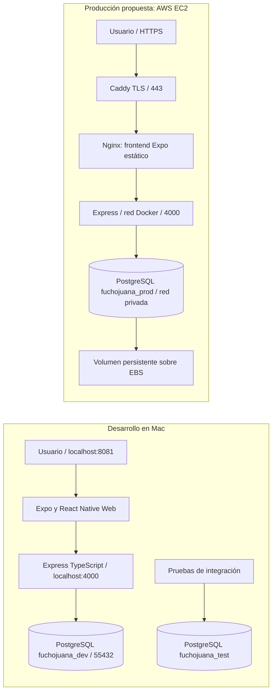
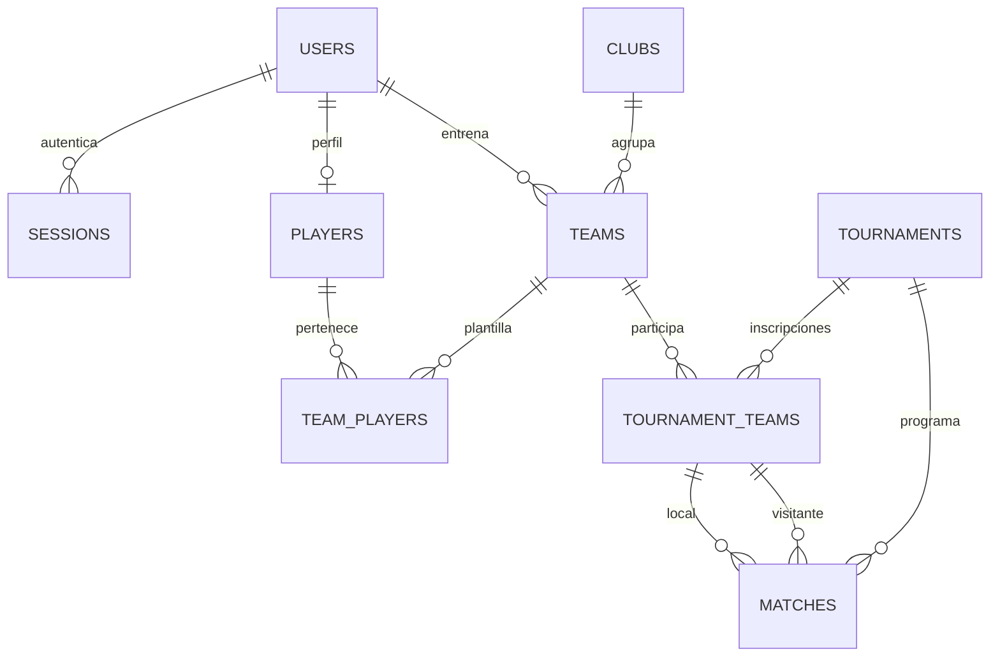

# Arquitectura

## Flujo y ambientes

Las bases y claves son distintas. El navegador nunca se conecta directamente a PostgreSQL. La aplicación se divide en presentación, controladores REST, servicios de dominio y acceso mediante Prisma. Los servicios validan roles, propiedad de equipos y reglas deportivas; PostgreSQL mantiene claves y restricciones incluso si un cliente intenta evitar la interfaz.

## Modelo relacional

Tablas normalizadas: `users`, `sessions`, `players`, `clubs`, `teams`, `team_players`, `tournaments`, `tournament_teams`, `matches`.

- Entidades principales: UUID, `createdAt`, `updatedAt`.
- Inscripciones y plantillas: clave primaria compuesta, `createdAt`; no tienen contenido mutable, se agregan/retiran.
- Correo, nombre de club y nombre de equipo únicos.
- Un perfil por cuenta de jugador, asociación opcional.
- Claves foráneas compuestas desde partidos a inscripciones: aseguran que ambos equipos pertenecen al torneo.
- Restricciones SQL: equipos distintos, fechas ordenadas, números de camiseta y resultados válidos.
- Índices en referencias y `(tournamentId, kickoff)`.
- Borrados protegidos en clubes con equipos, equipos inscritos y torneos con partidos. Las asociaciones simples de plantilla se eliminan en cascada al borrar el jugador/equipo.
- Las sesiones se eliminan al cerrar sesión, y su vencimiento se comprueba en cada petición.

El SQL original y la migración posterior que usa `NO ACTION` están en `database/prisma/migrations`. La segunda mejora compatibilidad de errores con PostgreSQL 18 y conserva la protección referencial.

## Servicios de nube previstos

| Servicio             | Función                                                   |
| -------------------- | --------------------------------------------------------- |
| EC2                  | VM que ejecuta contenedores de frontend, API y PostgreSQL |
| EBS                  | Disco persistente que almacena el volumen PostgreSQL      |
| VPC / Security Group | Permite únicamente HTTPS/HTTP y SSH restringido           |

PostgreSQL en contenedor sobre EC2 es autogestionado, **no RDS**. Es una elección sencilla para el MVP; respaldos y actualizaciones son responsabilidad del operador. Se puede migrar a RDS PostgreSQL modificando `DATABASE_URL` y las dependencias del compose, con reglas de acceso privadas.

La VM objetivo es Ubuntu Server 24.04, t3.small (2 vCPU, 2 GiB RAM), 20 GiB gp3. Docker ejecuta Node.js 24 y PostgreSQL 18. Nginx sirve archivos estáticos y enruta API; Caddy administra HTTPS. PM2 no se usa. La instancia real, IP, región y dominio se deben registrar tras desplegar.

## Decisiones del MVP

- Expo + React Native Web cumplen la tecnología solicitada conservando componentes reutilizables.
- Prisma 6.19 y Expo 55 se fijan para reproducibilidad, sin migrar durante el proyecto a versiones preliminares.
- Las rutas actúan como controladores delgados; no se agrega una capa vacía de controladores o repositorios que solo reenvíe llamadas.
- Docker reemplaza PM2 y configura el mismo conjunto de servicios de forma reproducible.
- La app web guarda JWT en almacenamiento de sesión; no se ha implementado refresh token. Requiere volver a iniciar sesión tras ocho horas.
- El MVP permite consulta de perfiles básicos a usuarios autenticados. Antes de usar datos reales de menores se debe reducir el acceso y definir políticas de privacidad acordes al uso real.

Fuentes técnicas: [Expo Web](https://docs.expo.dev/workflow/web/), [Prisma Migrate](https://www.prisma.io/docs/orm/v6/prisma-migrate/workflows/development-and-production), [tipos EC2](https://docs.aws.amazon.com/ec2/latest/instancetypes/gp.html).
